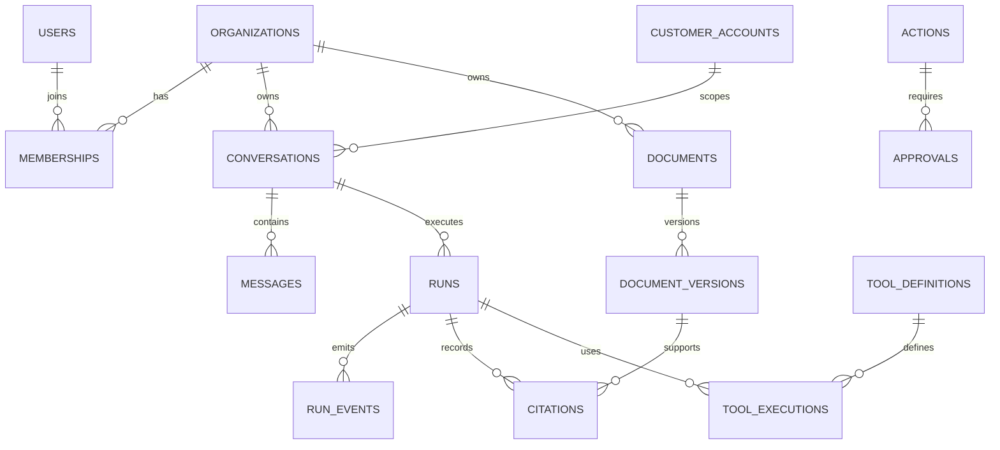

# Phase 1 initial database schema and persistence strategy

PostgreSQL is the system of record. All tenant-owned tables carry `organization_id` unless the entity is global and explicitly documented as such. UUID primary keys, UTC timestamps, optimistic/version columns where concurrent updates matter, foreign keys, and restrictive deletes are defaults. Application queries always begin with an authorized organization context; row-level security remains an additional Phase 2 defense-in-depth decision, not the sole control.

## Core relational entities

| Table | Key fields | Purpose and constraints |
| --- | --- | --- |
| `users` | `id`, external subject, status | Global authenticated identity; no client-controlled role |
| `organizations` | `id`, name, status, settings version | Tenant root |
| `memberships` | organization/user/role, status | Unique organization-user membership; source of request membership context |
| `roles`, `permissions`, `role_permissions` | stable identifiers | Global permission definitions and role mapping; tenant overrides are explicit settings |
| `customer_accounts` | organization, external account reference | Customer boundary; a customer user maps only to allowed account(s) |
| `conversations` | organization, workspace kind, customer account, owner, title, status | Authorizable thread; customer workspace requires customer account ownership |
| `messages` | conversation, run, author type, content reference, sequence | Ordered immutable conversation messages; sensitive content policy is configurable |
| `runs` | organization, conversation, requester, status, route, checkpoint reference, cancellation/version fields | Trackable execution; state transitions are validated |
| `run_events` | run, monotonic sequence, type, sanitized payload | Durable UI/diagnostic timeline, not chain-of-thought storage |
| `citations` | run/message, document version, chunk reference, locator | References actual retrieval results only |
| `agent_definitions`, `agent_capabilities` | id/version/policy | Configured agent boundary and allowed data/tool capabilities |
| `tool_definitions`, `tool_executions` | integration, schema version, risk, request/outcome | Registered tool contracts and audited invocation records |
| `actions`, `approvals` | action digest, risk, status, approver | Future controlled mutation lifecycle; R1 actions stay non-executable |
| `documents`, `document_versions`, `document_access_rules` | organization, source, classification, version, state | Ownership, lifecycle, classification, customer/public eligibility |
| `ingestion_jobs`, `jobs` | job type, state, attempt/lease, payload reference | Durable background work and retry/lease behavior |
| `integrations`, `tenant_integration_settings` | integration identity, encrypted secret reference, enabled policy | Integration config without storing raw secrets |
| `model_routing_policies`, `model_usage_records` | task, provider/model, cost/token/latency | Configured routing and measured usage |
| `audit_events` | actor, organization, action/resource, outcome, correlation ID | Append-only security and compliance history |

## Essential relationships

## Vector, cache, and checkpoint persistence

- Qdrant stores vectors only with `organization_id`, workspace/audience classification, document/version/chunk identifiers, source, access labels, deletion state, and embedding-model version metadata. Queries always apply a server-constructed metadata filter before returning content.
- Redis holds only short-lived cache/rate-limit/coordination records. Cache keys include scope/version dimensions such as organization, capability policy, source/data version, model policy, and request hash. Sensitive or volatile data is ineligible by default.
- LangGraph checkpoint values are durable in PostgreSQL. They are linked to a run but cannot authorize access by checkpoint/thread identifier alone.

## Index, retention, and migration rules

Indexes are required for organization-scoped lookups, membership lookup by external subject, conversation/run listing, run-event sequence, active job leases, document/version status, audit correlation ID, and the metadata fields used by retrieval filters. Retention periods remain configurable owner decisions. Deletion marks vectors inaccessible immediately, queues physical deletion/reindexing, and preserves only the audit information policy permits.

Alembic owns forward-only migrations. Each migration needs a rollback/repair note, tenant-safe backfill plan, and test against an empty and populated database. Destructive migrations are not run automatically without an approved backup and recovery plan.
